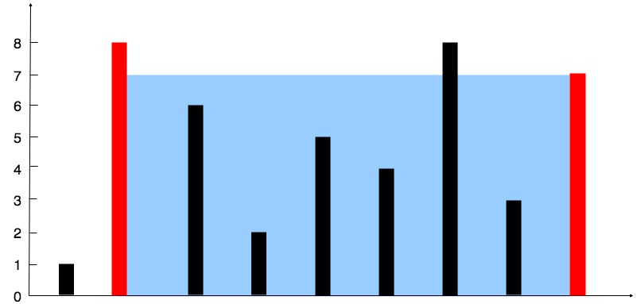

# 11. Container With Most Water

## Problem Description
You are given an integer array height of length n. There are n vertical lines drawn such that the two endpoints of the ith line are (i, 0) and (i, height[i]).  

Find two lines that together with the x-axis form a container, such that the container contains the most water.  

Return the maximum amount of water a container can store.  

Notice that you may not slant the container.  


## Sample Test Cases

Input: height = [1,8,6,2,5,4,8,3,7]  
Output: 49  
Explanation: The above vertical lines are represented by array [1,8,6,2,5,4,8,3,7]. In this case, the max area of water (blue section) the container can contain is 49.  

Example 2:  
Input: height = [1,1]  
Output: 1  


## Brute Force - Time Limit Exceeded
| Section              | Details                                 |
| -------------------- | --------------------------------------- |
| **Intuition**        | Try all possible pairs and compute area |
| **Approach**         | Nested loops checking every `(i, j)`    |
| **Time Complexity**  | `O(n²)`                                 |
| **Space Complexity** | `O(1)`                                  |

```
class Solution {
    public int maxArea(int[] height) {
        int max = 0;
        for (int i = 0; i < height.length; i++) {
            for (int j = i + 1; j < height.length; j++) {
                int area = Math.min(height[i], height[j]) * (j - i);
                if (area > max) max = area;
            }
        }
        return max;
    }
}
```

## two-pointer / greedy two-end shrink
| Section              | Details                                                      |
| -------------------- | ------------------------------------------------------------ |
| **Intuition**        | Area depends on shorter line; move the smaller height inward |
| **Approach**         | Start from both ends and shrink toward center                |
| **Time Complexity**  | `O(n)`                                                       |
| **Space Complexity** | `O(1)`                                                       |

```java
class Solution {
    public int maxArea(int[] height) {
        int i = 0, j = height.length - 1;
        int ans = 0;
        while (i < j) {
            int t = Math.min(height[i], height[j]) * (j - i);
            ans = Math.max(ans, t);
            if (height[i] < height[j]) {
                i++;
            } else {
                j--;
            }
        }
        return ans;
    }
}
```

## Binary Search
| Section              | Details                                             |
| -------------------- | --------------------------------------------------- |
| **Intuition**        | Binary search the maximum possible area             |
| **Approach**         | Guess area, verify if achievable using two pointers |
| **Time Complexity**  | `O(n log(maxArea))`                                 |
| **Space Complexity** | `O(1)`                                              |
| **Why It’s Bad**     | Slower and unnecessary when O(n) exists             |

```
class Solution {
    public int maxArea(int[] height) {
        int low = 0, high = 0;
        for (int h : height) high = Math.max(high, h);
        high *= height.length;

        while (low < high) {
            int mid = (low + high + 1) / 2;
            if (can(mid, height)) low = mid;
            else high = mid - 1;
        }
        return low;
    }

    boolean can(int area, int[] h) {
        int i = 0, j = h.length - 1;
        while (i < j) {
            if (Math.min(h[i], h[j]) * (j - i) >= area) return true;
            if (h[i] < h[j]) i++;
            else j--;
        }
        return false;
    }
}
```

## Divide & Conquer - Time Limit Exceeded
| Section              | Details                                   |
| -------------------- | ----------------------------------------- |
| **Intuition**        | Try all boundary combinations recursively |
| **Approach**         | Reduce left or right boundary recursively |
| **Time Complexity**  | `O(2ⁿ)`                                   |
| **Space Complexity** | `O(n)`                                    |
| **Why It Fails**     | Massive overlapping subproblems           |

```
class Solution {
    public int maxArea(int[] height) {
        return solve(height, 0, height.length - 1);
    }

    int solve(int[] h, int l, int r) {
        if (l >= r) return 0;
        int area = Math.min(h[l], h[r]) * (r - l);
        int left = solve(h, l + 1, r);
        int right = solve(h, l, r - 1);
        return Math.max(area, Math.max(left, right));
    }
}
```

## Approach Comparison
| Approach         | Time         | Space  | Status    | Notes              |
| ---------------- | ------------ | ------ | --------- | ------------------ |
| Brute Force      | `O(n²)`      | `O(1)` | ❌ TLE     | Baseline only      |
| Two-Pointer      | `O(n)`       | `O(1)` | ✅ Optimal | Interview favorite |
| Binary Search    | `O(n log n)` | `O(1)` | ❌         | Overengineering    |
| Divide & Conquer | Exponential  | `O(n)` | ❌ TLE     | Theoretical trap   |


## Summary

- Two-pointer greedy is the only correct choice
- Any solution slower than O(n) is unjustified
- Key insight: area limited by shorter height
- ⭐ Classic problem testing greedy intuition