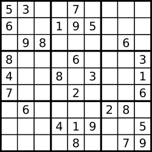

# 36. Valid Sudoku
Determine if a 9 x 9 Sudoku board is valid. Only the filled cells need to be validated according to the following rules:

- Each row must contain the digits 1-9 without repetition.
- Each column must contain the digits 1-9 without repetition.
- Each of the nine 3 x 3 sub-boxes of the grid must contain the digits 1-9 without repetition.  
### Note:
- A Sudoku board (partially filled) could be valid but is not necessarily solvable.
- Only the filled cells need to be validated according to the mentioned rules.
 
## Sample Test Cases
Example 1:  

```
Input: board = 
[["5","3",".",".","7",".",".",".","."]
,["6",".",".","1","9","5",".",".","."]
,[".","9","8",".",".",".",".","6","."]
,["8",".",".",".","6",".",".",".","3"]
,["4",".",".","8",".","3",".",".","1"]
,["7",".",".",".","2",".",".",".","6"]
,[".","6",".",".",".",".","2","8","."]
,[".",".",".","4","1","9",".",".","5"]
,[".",".",".",".","8",".",".","7","9"]]
Output: true
```
Example 2:

```
Input: board = 
[["8","3",".",".","7",".",".",".","."]
,["6",".",".","1","9","5",".",".","."]
,[".","9","8",".",".",".",".","6","."]
,["8",".",".",".","6",".",".",".","3"]
,["4",".",".","8",".","3",".",".","1"]
,["7",".",".",".","2",".",".",".","6"]
,[".","6",".",".",".",".","2","8","."]
,[".",".",".","4","1","9",".",".","5"]
,[".",".",".",".","8",".",".","7","9"]]
Output: false
```
Explanation: Same as Example 1, except with the 5 in the top left corner being modified to 8. Since there are two 8's in the top left 3x3 sub-box, it is invalid.


## Brute Force Approach
| Section              | Details                                                                                      |
| -------------------- | -------------------------------------------------------------------------------------------- |
| **Intuition**        | Validate each row, column, and sub-box separately for duplicates.                            |
| **Approach**         | Use a boolean array for each row, column, and 3×3 box to check if a number already appeared. |
| **Time Complexity**  | `O(81)`                                                                                      |
| **Space Complexity** | `O(1)`                                                                                       |

```
class Solution {
    public boolean isValidSudoku(char[][] board) {
        
        // Check all rows
        for (int r = 0; r < 9; r++) {
            boolean[] seen = new boolean[9];
            for (int c = 0; c < 9; c++) {
                if (board[r][c] == '.') continue;
                int num = board[r][c] - '1';
                if (seen[num]) return false;
                seen[num] = true;
            }
        }

        // Check all columns
        for (int c = 0; c < 9; c++) {
            boolean[] seen = new boolean[9];
            for (int r = 0; r < 9; r++) {
                if (board[r][c] == '.') continue;
                int num = board[r][c] - '1';
                if (seen[num]) return false;
                seen[num] = true;
            }
        }

        // Check all 3×3 boxes
        for (int box = 0; box < 9; box++) {
            boolean[] seen = new boolean[9];
            int br = (box / 3) * 3;
            int bc = (box % 3) * 3;
            for (int r = br; r < br + 3; r++) {
                for (int c = bc; c < bc + 3; c++) {
                    if (board[r][c] == '.') continue;
                    int num = board[r][c] - '1';
                    if (seen[num]) return false;
                    seen[num] = true;
                }
            }
        }
        return true;
    }
}
```

## Hashing / Frequency-Counting Approach
| Section              | Details                                                                                           |
| -------------------- | ------------------------------------------------------------------------------------------------- |
| **Intuition**        | Track occurrences of digits using 3 frequency grids for rows, columns, and boxes.                 |
| **Approach**         | Convert each filled digit into an index and mark it in row/col/box matrices. Duplicate → invalid. |
| **Time Complexity**  | `O(81)`                                                                                           |
| **Space Complexity** | `O(1)`                                                                                            |

```
class Solution {
    public boolean isValidSudoku(char[][] board) {
        int[][] rows = new int[9][9];
        int[][] cols = new int[9][9];
        int[][] boxes = new int[9][9];
        for (int r = 0; r < 9; r++) {
            for (int c = 0; c < 9; c++) {
                if (board[r][c] == '.') continue;
                int num = board[r][c] - '1';
                int boxIndex = (r / 3) * 3 + (c / 3);
                if (rows[r][num] == 1 || cols[c][num] == 1 || boxes[boxIndex][num] == 1) return false;
                rows[r][num] = 1;
                cols[c][num] = 1;
                boxes[boxIndex][num] = 1;
            }
        }
        return true;
    }
}
```

## HashSet Encoding Approach
| Section              | Details                                                                          |
| -------------------- | -------------------------------------------------------------------------------- |
| **Intuition**        | Encode each constraint (row/col/box) as a string and store in a HashSet.         |
| **Approach**         | If an encoded string already exists in the set, the board violates Sudoku rules. |
| **Time Complexity**  | `O(81)`                                                                          |
| **Space Complexity** | `O(81)`                                                                          |

```
class Solution {
    public boolean isValidSudoku(char[][] board) {
         Set<String> seen = new HashSet<>();
        for (int r = 0; r < 9; r++) {
            for (int c = 0; c < 9; c++) {
                char val = board[r][c];
                if (val == '.') continue;
                if (!seen.add(val + " in row " + r) ||
                    !seen.add(val + " in col " + c) ||
                    !seen.add(val + " in box " + (r/3) + "-" + (c/3))) {
                    return false;
                }
            }
        }
        return true;
    }
}
```

## Bitmasking Approach
| Section              | Details                                                                 |
| -------------------- | ----------------------------------------------------------------------- |
| **Intuition**        | Instead of arrays, use bitmasks where each bit represents a number 1–9. |
| **Approach**         | Check/set bits for rows, columns, and boxes. Duplicate bit → invalid.   |
| **Time Complexity**  | `O(81)`                                                                 |
| **Space Complexity** | `O(1)`                                                                  |

```
class Solution {
    public boolean isValidSudoku(char[][] board) {
        int[] rows = new int[9];
        int[] cols = new int[9];
        int[] boxes = new int[9];
        for (int r = 0; r < 9; r++) {
            for (int c = 0; c < 9; c++) {
                if (board[r][c] == '.') continue;
                int bit = 1 << (board[r][c] - '1');
                int box = (r / 3) * 3 + (c / 3);
                if ((rows[r] & bit) != 0 || 
                    (cols[c] & bit) != 0 || 
                    (boxes[box] & bit) != 0) return false;
                rows[r] |= bit;
                cols[c] |= bit;
                boxes[box] |= bit;
            }
        }
        return true;
    }
}
```

## Boolean Array Approach
| Section              | Details                                                             |
| -------------------- | ------------------------------------------------------------------- |
| **Intuition**        | Similar to frequency-counting but uses booleans instead of ints.    |
| **Approach**         | If digit already marked in row/col/box boolean array, it's invalid. |
| **Time Complexity**  | `O(81)`                                                             |
| **Space Complexity** | `O(1)`                                                              |

```
class Solution {
    public boolean isValidSudoku(char[][] board) {
        boolean[][] rows = new boolean[9][9];
        boolean[][] cols = new boolean[9][9];
        boolean[][] boxes = new boolean[9][9];
        for (int r = 0; r < 9; r++) {
            for (int c = 0; c < 9; c++) {
                if (board[r][c] == '.') continue;
                int num = board[r][c] - '1';
                int box = (r / 3) * 3 + (c / 3);
                if (rows[r][num] || cols[c][num] || boxes[box][num]) return false;
                rows[r][num] = cols[c][num] = boxes[box][num] = true;
            }
        }
        return true;
    }
}
```

## One Pass Single Array
| Section              | Details                                                                                              |
| -------------------- | ---------------------------------------------------------------------------------------------------- |
| **Intuition**        | Use a single boolean array with cleverly calculated indexes to track row/col/box constraints.        |
| **Approach**         | Flatten all constraints into unique indices inside a single seen[] array. Duplicate index → invalid. |
| **Time Complexity**  | `O(81)`                                                                                              |
| **Space Complexity** | `O(1)`                                                                                               |

```
class Solution {
    public boolean isValidSudoku(char[][] board) {
        boolean[] seen = new boolean[400];
        for (int r = 0; r < 9; r++) {
            for (int c = 0; c < 9; c++) {
                if (board[r][c] == '.') continue;
                int num = board[r][c] - '1';
                int box = (r / 3) * 3 + (c / 3);

                int rowIndex = r * 9 + num;
                int colIndex = 100 + c * 9 + num;
                int boxIndex = 200 + box * 9 + num;

                if (seen[rowIndex] || seen[colIndex] || seen[boxIndex]) return false;

                seen[rowIndex] = seen[colIndex] = seen[boxIndex] = true;
            }
        }
        return true;
    }
}
```

## Approach Comparison
| Approach                     | Time Complexity | Space Complexity | Notes                 |
| ---------------------------- | --------------- | ---------------- | --------------------- |
| Brute Force                  | O(81)           | O(1)             | Simple but repetitive |
| Hashing / Frequency Counting | O(81)           | O(1)             | Clean & reliable      |
| HashSet Encoding             | O(81)           | O(81)            | Easiest to understand |
| Bitmasking                   | O(81)           | O(1)             | **Most optimized**    |
| Boolean Array                | O(81)           | O(1)             | Lightweight           |
| One Pass Single Array        | O(81)           | O(1)             | Smart indexing trick  |


## Summary

- Optimal Approach: Bitmasking
- Why:
- - Uses constant space
- - Fast bitwise operations
- - Cleanest & most performant