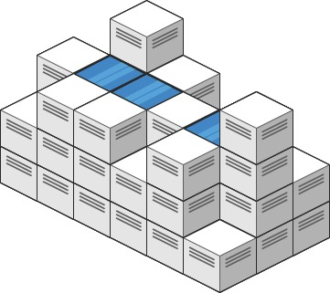
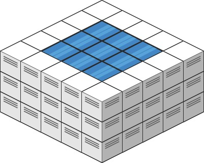

# 407. Trapping Rain Water II

## Problem Statement

Given an `m x n` matrix `heightMap` representing the heights of cells in a 2D elevation map, return the total volume of water the map can trap after raining.

The map has between 1 and 200 rows and columns, and each cell height is between 0 and `2 * 10^4`.

## Sample Test Cases

### Example 1

```text
Input: heightMap = [[1,4,3,1,3,2],[3,2,1,3,2,4],[2,3,3,2,3,1]]
Output: 4
```

The two interior ponds trap 1 and 3 units of water, respectively.



### Example 2

```text
Input: heightMap = [[3,3,3,3,3],[3,2,2,2,3],[3,2,1,2,3],[3,2,2,2,3],[3,3,3,3,3]]
Output: 10
```



## Min-Heap Boundary Expansion (Dijkstra-like) ✅

| Section | Details |
|---|---|
| **Intuition** | Water at an interior cell is limited by the lowest boundary level through which it can escape. Expanding inward from the lowest available boundary keeps track of that limiting level. |
| **Approach** | Add every boundary cell to a min-heap and mark it visited. Repeatedly remove the lowest cell and inspect its unvisited neighbors. Any water above a neighbor's height is trapped up to the current boundary level; add that amount to the answer, then push the neighbor with effective height `max(current level, neighbor height)`. |
| **Time Complexity** | `O(mn log(mn))`, since each cell is inserted into and removed from the priority queue once. |
| **Space Complexity** | `O(mn)` for the visited matrix and priority queue. |

```java
class Solution {
    public int trapRainWater(int[][] heightMap) {
        int m = heightMap.length, n = heightMap[0].length;
        boolean[][] vis = new boolean[m][n];
        PriorityQueue<int[]> pq = new PriorityQueue<>((a, b) -> a[0] - b[0]);
        for (int i = 0; i < m; ++i) {
            for (int j = 0; j < n; ++j) {
                if (i == 0 || i == m - 1 || j == 0 || j == n - 1) {
                    pq.offer(new int[] {heightMap[i][j], i, j});
                    vis[i][j] = true;
                }
            }
        }
        int ans = 0;
        int[] dirs = {-1, 0, 1, 0, -1};
        while (!pq.isEmpty()) {
            var p = pq.poll();
            for (int k = 0; k < 4; ++k) {
                int x = p[1] + dirs[k], y = p[2] + dirs[k + 1];
                if (x >= 0 && x < m && y >= 0 && y < n && !vis[x][y]) {
                    ans += Math.max(0, p[0] - heightMap[x][y]);
                    vis[x][y] = true;
                    pq.offer(new int[] {Math.max(p[0], heightMap[x][y]), x, y});
                }
            }
        }
        return ans;
    }
}
```

## Summary

- Start from the map's boundary, since water can escape through its perimeter.
- Expanding the lowest effective boundary first determines how much water each newly visited cell can retain.
- The min-heap makes the traversal `O(mn log(mn))` while processing every cell once.
