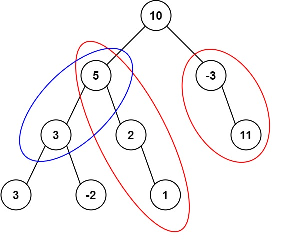

# 437. Path Sum III

## Problem Statement

Given the root of a binary tree and an integer `targetSum`, return the number of downward paths whose node values sum to `targetSum`. A path may start and end at any nodes, but must travel from parent to child.

The tree contains 0 to 1000 nodes. Node values are between `-10^9` and `10^9`, and `targetSum` is between `-1000` and `1000`.

## Sample Test Cases

### Example 1

```text
Input: root = [10,5,-3,3,2,null,11,3,-2,null,1], targetSum = 8
Output: 3
```



### Example 2

```text
Input: root = [5,4,8,11,null,13,4,7,2,null,null,5,1], targetSum = 22
Output: 3
```

## Prefix Sum + Hash Map with DFS ✅

| Section | Details |
|---|---|
| **Intuition** | For the current root-to-node path with sum `s`, a downward path ending at this node sums to `targetSum` when an earlier prefix sum equals `s - targetSum`. |
| **Approach** | Keep counts of prefix sums on the current DFS path, initially including `0` once. At each node, add the count for `currentSum - targetSum`, record the current sum, recurse into both children, then remove the current sum from the map when backtracking. The frequency map preserves multiple matching starting points. |
| **Time Complexity** | `O(N)` expected, where `N` is the number of nodes, assuming expected `O(1)` hash-map operations. |
| **Space Complexity** | `O(H)` for the map and recursion stack along the current path, where `H` is the tree height. |

```java
class Solution {
    private Map<Long, Integer> cnt = new HashMap<>();
    private int targetSum;

    public int pathSum(TreeNode root, int targetSum) {
        cnt.put(0L, 1);
        this.targetSum = targetSum;
        return dfs(root, 0);
    }

    private int dfs(TreeNode node, long s) {
        if (node == null) {
            return 0;
        }
        s += node.val;
        int ans = cnt.getOrDefault(s - targetSum, 0);
        cnt.merge(s, 1, Integer::sum);
        ans += dfs(node.left, s);
        ans += dfs(node.right, s);
        cnt.merge(s, -1, Integer::sum);
        return ans;
    }
}
```

## Prefix Sum + DFS

| Section | Details |
|---|---|
| **Intuition** | Use the same prefix-sum relationship: earlier prefixes that differ from the current sum by `targetSum` identify valid paths ending at the current node. |
| **Approach** | Pass the prefix-sum frequency map through recursion. Add the current node's sum before visiting its children and decrement its frequency afterward so prefixes from one branch are not counted in another branch. |
| **Time Complexity** | `O(N)` expected, assuming expected `O(1)` hash-map operations. |
| **Space Complexity** | `O(H)` for the map and recursion stack along the current path, where `H` is the tree height. |

```java
/**
 * Definition for a binary tree node.
 * public class TreeNode {
 *     int val;
 *     TreeNode left;
 *     TreeNode right;
 *     TreeNode() {}
 *     TreeNode(int val) { this.val = val; }
 *     TreeNode(int val, TreeNode left, TreeNode right) {
 *         this.val = val;
 *         this.left = left;
 *         this.right = right;
 *     }
 * }
 */
class Solution {
    public int pathSum(TreeNode root, int targetSum) {
        Map<Long, Integer> map = new HashMap<>();
        map.put(0L, 1);
        return dfs(root, 0, targetSum, map);
    }

    private int dfs(TreeNode node, long currSum, int target, Map<Long, Integer> map) {
        if (node == null) return 0;
        currSum += node.val;
        int res = map.getOrDefault(currSum - target, 0);
        map.put(currSum, map.getOrDefault(currSum, 0) + 1);
        res += dfs(node.left, currSum, target, map);
        res += dfs(node.right, currSum, target, map);
        map.put(currSum, map.get(currSum) - 1);
        return res;
    }
}
```

## Approach Comparison

| Approach | Time Complexity | Space Complexity | Notes |
|---|---|---|---|
| Prefix sums with instance fields | `O(N)` expected | `O(H)` | Stores the target and prefix-count map as fields. |
| Prefix sums passed through DFS | `O(N)` expected | `O(H)` | Passes the target and prefix-count map as method arguments. |

## Summary

- A path ending at the current node is found by looking up the prefix sum `currentSum - targetSum`.
- Store prefix-sum frequencies, not just presence, to count multiple matching paths.
- Backtrack the current prefix sum after exploring its children so sibling branches remain independent.
