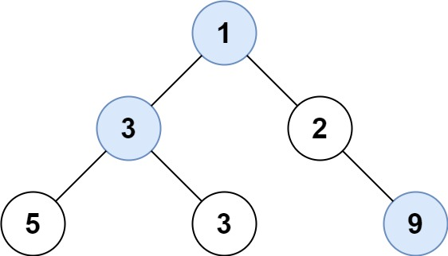

# 515. Find Largest Value in Each Tree Row

## Problem Statement

Given the root of a binary tree, return an array containing the largest value in each row, with the root at row 0.

The tree contains between 0 and `10^4` nodes. Node values are in the range `[-2^31, 2^31 - 1]`.

## Sample Test Cases

### Example 1

```text
Input: root = [1,3,2,5,3,null,9]
Output: [1,3,9]
```



### Example 2

```text
Input: root = [1,2,3]
Output: [1,3]
```

## Breadth-First Search (Level-Order Traversal) ✅

| Section | Details |
|---|---|
| **Intuition** | Level-order traversal visits all nodes in a row together, so their maximum can be recorded before moving to the next row. |
| **Approach** | Add the root to a queue. For each level, process the queue's current size, track the largest node value, and enqueue its children. Append the maximum after finishing the level. |
| **Time Complexity** | `O(N)`, where `N` is the number of nodes. |
| **Space Complexity** | `O(W)` for the queue, where `W` is the maximum tree width; the returned list requires `O(H)` space for `H` levels. |

```java
class Solution {
    public List<Integer> largestValues(TreeNode root) {
        List<Integer> ans = new ArrayList<>();
        if (root == null) {
            return ans;
        }
        Deque<TreeNode> q = new ArrayDeque<>();
        q.offer(root);
        while (!q.isEmpty()) {
            int t = q.peek().val;
            for (int i = q.size(); i > 0; --i) {
                TreeNode node = q.poll();
                t = Math.max(t, node.val);
                if (node.left != null) {
                    q.offer(node.left);
                }
                if (node.right != null) {
                    q.offer(node.right);
                }
            }
            ans.add(t);
        }
        return ans;
    }
}
```

## Depth-First Search with Level Tracking

| Section | Details |
|---|---|
| **Intuition** | Each node belongs to a known depth; keep the largest value seen so far for that depth. |
| **Approach** | Traverse the tree recursively, passing the current level. Add a value when the level is first reached; otherwise update that level's maximum. |
| **Time Complexity** | `O(N)`, where `N` is the number of nodes. |
| **Space Complexity** | `O(H)` for the recursion stack, where `H` is the tree height; the returned list uses `O(H)` space. |

```java
class Solution {
    public List<Integer> largestValues(TreeNode root) {
        List<Integer> res = new ArrayList<>();
        dfs(root, 0, res);
        return res;
    }

    private void dfs(TreeNode node, int level, List<Integer> res) {
        if (node == null) return;
        if (level == res.size()) {
            res.add(node.val);
        } else {
            res.set(level, Math.max(res.get(level), node.val));
        }
        dfs(node.left, level + 1, res);
        dfs(node.right, level + 1, res);
    }
}
```

## Approach Comparison

| Approach | Time Complexity | Auxiliary Space | Notes |
|---|---|---|---|
| Breadth-first search | `O(N)` | `O(W)` queue | Processes one complete row at a time. |
| Depth-first search | `O(N)` | `O(H)` recursion stack | Tracks and updates the maximum for each level. |

Here, `W` is the maximum tree width and `H` is the tree height. The output list takes `O(H)` space in either approach.

## Summary

- Both traversals visit every node once and compute one maximum per tree level.
- BFS naturally groups nodes by row; DFS uses the depth to update the corresponding maximum.
- BFS uses space proportional to the maximum width, while DFS uses recursion space proportional to the height.
